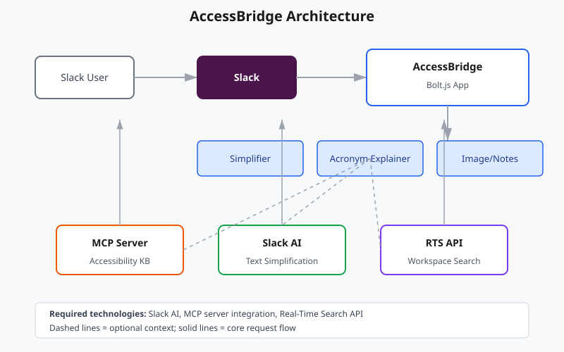

# AccessBridge — Final Devpost Submission (Copy-Paste Ready)

## Project Title

AccessBridge: Plain Language Translator for People with Disabilities

## Tagline / One-Sentence Summary

A Slack agent that simplifies workplace communication so everyone can understand.

## About The Project

My teammate once missed a critical policy update because the message was full of HR acronyms and legal wording. For most of us, that's annoying. For people with cognitive disabilities, dyslexia, vision impairments, or anyone reading Slack in a second language, it can mean missing information that affects their job.

AccessBridge is a Slack agent I built to fix this. It sits inside the channels where people already talk and turns complex messages into plain language, explains acronyms, describes images, and structures meeting notes — all without leaving Slack.

## How It Works

When someone runs `/simplify` or mentions `@AccessBridge`, the Bolt.js app detects the intent and routes the request. The simplifier first tries Vertex AI Gemini to rewrite the text in plain language, then falls back to rule-based rewriting if Vertex AI is not configured. Every result is scored with Flesch-Kincaid so the improvement is measurable.

If the message contains acronyms like ADA or WCAG, AccessBridge pulls a plain-language definition from a local MCP accessibility knowledge base. It can also use Slack Real-Time Search to show when that acronym has come up in the workspace before.

For images, it reads Slack file metadata and returns a structured alt-text suggestion. For meeting notes, it splits walls of text into Decisions, Action Items, and Context so the point is not buried.

## The 5 Workflows

- **Plain Language Simplifier** — lowers reading level and highlights key terms.
- **Image Alt Text** — generates structured image descriptions.
- **Meeting Notes Restructurer** — splits notes into Decisions, Action Items, and Context.
- **Acronym Explainer** — explains acronyms using an MCP accessibility knowledge base.
- **Jargon-Free Translation** — converts technical language into everyday words.

## Built With

- Slack Bolt
- Google Vertex AI (Gemini)
- Model Context Protocol (MCP)
- Slack Real-Time Search API

## Key Features

- AI-powered simplification via Vertex AI Gemini, with rule-based fallback.
- Measurable impact: every simplification shows reading level improvement.
- Grounded acronym explanations via MCP accessibility knowledge base.
- Workspace-aware context via Slack Real-Time Search API.
- Image alt-text guidance for screen-reader accessibility.
- Structured notes for cognitive accessibility.
- Message shortcuts — right-click any message to simplify or explain acronyms.
- App Home tab with instructions and example commands.
- Feedback buttons on every simplification.
- Screen-reader friendly formatting with plain-text fallbacks.
- Expanded accessibility knowledge base with 30+ terms.

## What Track Are You Submitting To?

Track 2: Slack Agent for Good

## Video Link

[Paste your YouTube/Loom URL here after recording]

## Source Repository

[Paste public or judge-accessible repo URL here]

## Try It Out

1. Create a Slack app from `manifest.json` at https://api.slack.com/apps
2. Install dependencies: `npm install`
3. Configure `.env` from `.env.example`
4. Start the app: `npm start`
5. In Slack: `@AccessBridge simplify this: [paste text]`

## Screenshots

### Screenshot 1: The input

A Slack channel message:

```
@AccessBridge simplify this
"In accordance with the revised ADA accommodations policy, all personnel are required to submit their WCAG compliance attestations prior to the fiscal year-end audit."
```

### Screenshot 2: The accessible response

```
*Plain-language version:*

"Under the updated disability-access policy, all staff must send in their WCAG compliance forms before the year-end check."

_Before: Grade 16 (difficult)_
_After: Grade 6 (easy to read)_
_Improved readability_

*Key terms to explain:*
• Acronyms: ADA, WCAG
```

### Screenshot 3: Architecture



See `architecture.md` for the full written explanation.

## Social Impact

About 15% of the global workforce lives with a disability, and many of them use Slack every day. A dense message does not just slow them down — it can exclude them from decisions, deadlines, and opportunities.

AccessBridge is built for Track 2 because workplace accessibility is a social good. Every time it drops a Grade 16 policy update to Grade 6, or explains what WCAG means, it removes a real barrier to information. The goal is not productivity enhancement. It is access to information itself.

## What's Next

- Connect to external vision models for richer image descriptions.
- Multi-language simplification.
- Personal reading-level preferences per user.
